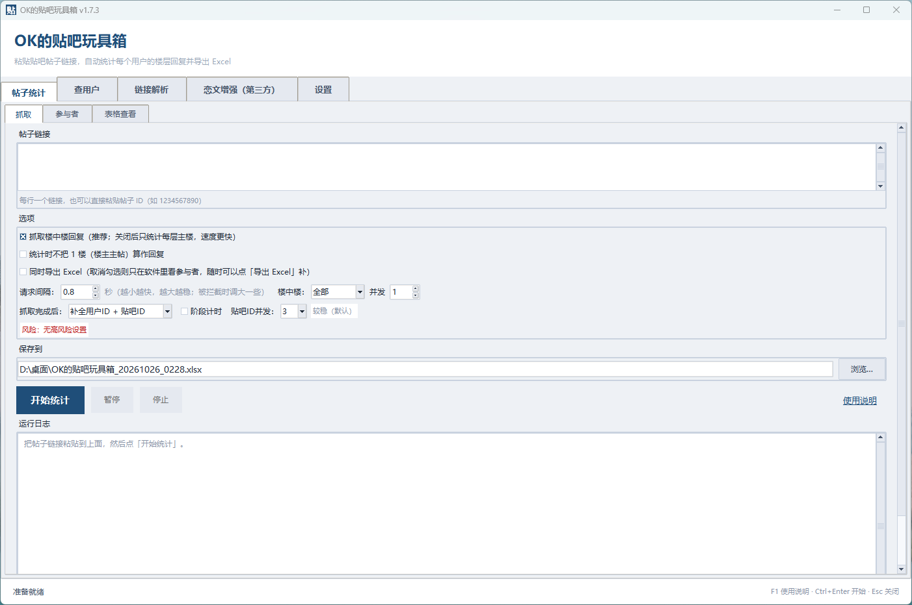
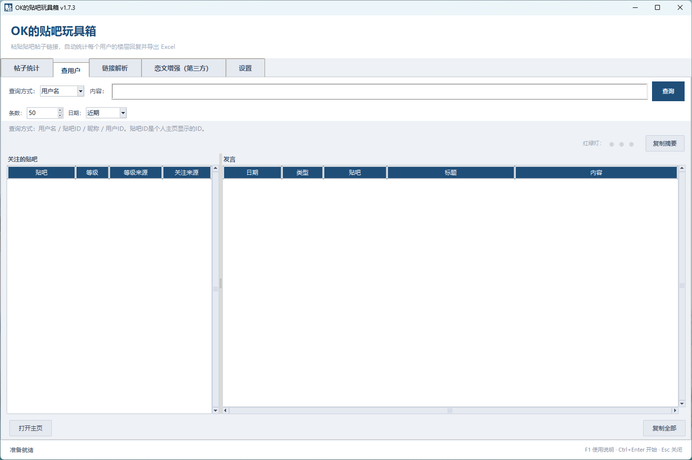

# OK的贴吧玩具箱（ok-tieba-toybox）

输入贴吧帖子链接，抓取**主题楼层 + 楼中楼**，按用户汇总，导出 Excel。  
默认匿名使用，不需要 Cookie；可选登录，用于验证码、关注检测和更完整的资料。

当前版本：**v1.7.3**

作者：**OK**（GitHub: [Goto-OK](https://github.com/Goto-OK)）

AI 协作：**DeepSeek**（代码实现、测试与文档整理，详见 [CREDITS.md](CREDITS.md)）

仓库：[Goto-OK/ok-tieba-toybox](https://github.com/Goto-OK/ok-tieba-toybox)

支持浅色 / 深色 / 跟随系统，以及蓝色、绿色、紫色、橘黄、粉色、青色、红色强调色。  
详细改动见 [CHANGELOG.md](CHANGELOG.md)。

> 本项目不是百度官方产品，与百度无隶属关系。请遵守贴吧用户协议和当地法律，控制抓取频率，不要用于骚扰、商业采集或账号买卖。

---

## 下载与运行

### Windows 绿色版

从 GitHub **Releases** 下载：

```text
ok-tieba-toybox_v1.7.3.zip
```

使用：

1. 解压完整压缩包；
2. 保留 `_internal` 目录，不要只复制 exe；
3. 运行 `OK的贴吧玩具箱.exe`。

当前包未使用受信任代码签名证书，Windows SmartScreen 可能提示“未知发布者”。

校验文件：

```text
SHA256SUMS-1.7.3.txt
```

### 从源码运行

```bash
python -m pip install -r requirements.lock
python tieba_gui.py
```

命令行基础用法：

```bash
python tieba_stats.py https://tieba.baidu.com/p/1234567890 -o 统计.xlsx
python tieba_stats.py <url1> <url2> --no-comments
python tieba_stats.py <url> --cookie "BDUSS=xxx"
```

Android 旧 APK 保留，但已暂停更新，不再承诺与桌面版功能同步。

---

## 功能

- **楼层与楼中楼抓取**：自动识别页数，楼中楼跨页去重；
- **按用户统计**：楼层数、楼中楼数、合计、等级、头衔、首次出现楼层；
- **参与者**：查看关注贴吧、发言（主题帖 + 回复）；
- **查用户**：用户名 / 用户ID / 昵称查询，支持条数与日期范围；
- **本地标记**：安全 / 可疑 / 警告三级，默认开启，支持 Excel 导入导出；
- **筛选**：关键词 / 等级 / 标记组合筛选，导出可选全部或当前筛选；
- **表格查看**：回复统计 / 楼层明细 / 楼中楼明细，可排序、打开链接；
- **Excel 导出**：多 sheet、超链接、冻结、筛选、合计行；
- **断点续抓**：验证码中断保留已完成部分，重试只补失败页；
- **登录与 WebView2**：内置百度登录、完整 Cookie / 仅 BDUSS、持久登录、切换账号；
- **手动 Cookie 预检**：检查登录态、验证码和常见字段缺失，不阻塞使用；
- **简洁 / 高级模式**：默认简洁，隐藏调参和高风险操作，登录功能两种模式一致；
- **测试中心**：`Ctrl+Shift+C`，可做离线检查和验证码流程模拟；
- **运行日志**：应用内查看/打开目录/删除，不写 Cookie 或正文。

## 截图

| 主界面 | 查用户 |
|---|---|
|  |  |

---

## 登录与 Cookie

### 游客模式

不需要 Cookie，适合公开帖子。

限制：

- 隐藏关注不可见；
- 部分资料/关注数据可能不完整。

### 仅 BDUSS

只发送：

```text
BDUSS=...
```

适合基础登录抓取和减少凭据暴露。

### 完整 Cookie

推荐从**已登录的贴吧页面**复制：

```text
https://tieba.baidu.com/
```

最好再打开目标帖子或任意吧，然后复制请求头 Cookie。

常见字段：

```text
BDUSS
STOKEN
TIEBAUID
TIEBA_SID
BAIDUID
```

说明：

- 百度首页登录 Cookie 通常也能通过登录检查，但可能缺 `STOKEN` / `TIEBAUID`；
- 未登录贴吧 Cookie 通常只有 `BAIDUID`，会被拒绝；
- 任意网站的 Cookie 不含百度登录态，不能使用；
- 手动粘贴字符串不包含域名，软件无法判断它来自贴吧还是百度首页；
- Cookie 是账号凭证，不要提交到仓库、Issue 或发给他人。

### 记住登录

- 默认只在内存；
- 勾选“记住 BDUSS / 完整 Cookie”后使用 Windows DPAPI 加密保存；
- “记住内置登录”会把 WebView2 登录态保存到本机独立目录；
- 共享电脑不要开启持久登录；
- 可在设置或登录区清除。

---

## 隐私

- 不收集遥测，不上传统计结果；
- 结果、标记、设置默认只保存在本机；
- 日志不记录 Cookie、BDUSS、STOKEN；
- 导出文件由用户自行保管；
- 清空数据会删除本地结果、设置、Cookie 和内置登录态，不删除已导出的 Excel。

详见 [PRIVACY.md](PRIVACY.md)。

---

## 环境

- Windows 10 / 11；
- Python 3.10+（源码运行；当前构建使用 Python 3.12）；
- 内置登录需要 Microsoft Edge WebView2 Runtime；
- 依赖：`openpyxl`、`lxml`；
- 可选：`pywebview`、`pythonnet`。

---

## 开发

```bash
python -m pip install -r requirements-dev.lock
python -m pip install -e . --no-deps
python -m ruff check .
python -m mypy
python -m pytest
python tests/selftest.py
python tieba_gui.py
```

版本号唯一来源：

```text
tieba_reply_stats/version.py
```

`pyproject.toml` 动态读取；`assets/version_info.txt` 由 `scripts/write_version_info.py` 生成。

### 构建 Windows 版

```powershell
powershell -NoProfile -ExecutionPolicy Bypass -File scripts/build_desktop.ps1 -Version 1.7.3
```

构建完成后：

```text
dist/OK的贴吧玩具箱_v1.7.3/
```

发布时同时生成绿色包和 `SHA256SUMS`。

---

## 项目结构

```text
ok-tieba-toybox/
├─ tieba_reply_stats/       核心包（抓取、解析、protobuf、导出）
├─ tieba_gui.py             Windows 桌面 GUI
├─ tieba_stats.py           命令行入口
├─ tests/                   单元测试、离线 fixtures、selftest
├─ tools/                   快照采集、查询等辅助工具
├─ scripts/                 构建、版本、同步脚本
├─ docs/                    规范、协议、发布、状态文档
├─ assets/                  图标、版本信息
├─ sample/                  示例 Excel
└─ 使用说明.txt              面向用户的完整说明
```

---

## 文档

- [实现规范（唯一依据）](SPEC.md)
- [文档索引](docs/README.md)
- [发布流程](docs/release.md)
- [GitHub 发布清单](docs/github-release.md)
- [开发规范](docs/standards.md)
- [代码地图](docs/code-map.md)
- [实现状态](docs/status.md)
- [手工验收用例](docs/test-cases.md)
- [更新日志](CHANGELOG.md)
- [用户使用说明](使用说明.txt)
- [参与开发](CONTRIBUTING.md)
- [安全问题](SECURITY.md)

---

## 限制与声明

- 使用贴吧网页/客户端内部接口，不是百度官方开放 API；接口可能变更、限流或失效；
- 隐藏关注无法完整枚举，只能部分恢复；
- 验证码需要人工完成，本软件不破解验证码；
- 请控制请求频率，不要用于恶意爬取、骚扰、账号买卖或商业采集；
- 软件按现状提供，不保证接口永久可用；
- 使用者应自行确认数据用途和当地法律要求。

---

## 许可证

[MIT](LICENSE)

Copyright (c) 2026 OK

如需以个人名义署名，可在 `LICENSE`、本 README、`pyproject.toml` 和关于页中替换为你的名字或常用 ID。
